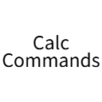

<p align="center">
  
</p>

---
<h1 align="center">Calc Commands</h1>

<p align="center">
  <strong>Calculate. Solve. Get back to building.</strong><br>
  A calculator in Minecraft chat — from stacks of blocks to symbolic math.
</p>

<!-- Badge placeholders: replace the Modrinth, CurseForge and QQ Group links when ready.
     Modrinth image: https://img.shields.io/modrinth/dt/PROJECT_ID?color=00AF5C&label=Modrinth%20downloads&logo=modrinth
     CurseForge image: https://img.shields.io/curseforge/dt/PROJECT_ID?logo=curseforge&label=CurseForge%20downloads&color=f16436
     QQ Group: add the group number to the badge label and replace #downloads with the invite URL.
-->
<p align="center">
  <a href="LICENSE"></a>
  <a href="#downloads"></a>
  <a href="#downloads"></a><br>
  <a href="https://github.com/Piscescup/calc-commands"></a>
  <a href="https://github.com/Piscescup/calc-commands/releases"></a>
</p>

<div align="center">

[Installation](#installation) · [Quick Start](#quick-start) · [Commands](#commands) · [Command Reference](docs/commands.md) · [Downloads](#downloads)

</div>

---

**A client mod for minecraft, apply powerful commands of math**

## Features

|                           | What you can do                                                                                    |
|:--------------------------|:---------------------------------------------------------------------------------------------------|
| **Everyday calculations** | Count materials, divide stacks, calculate distances and convert angles.                            |
| **Exact answers**         | Keep fractions and radicals, see decimal approximations, and reuse the previous answer with `ans`. |
| **Algebra & calculus**    | Solve equations, expand, factor, simplify, differentiate, integrate and find limits.               |
| **Complex numbers**       | Enable complex mode for calculations and solutions involving `I`.                                  |
| **Inventory quantities**  | Display non-negative results as shulker boxes, stacks and remaining items.                         |
| **Help in chat**          | Get input hints and Tab completion; browse grouped help and click examples to edit them.           |

**Client-side.** Works in singleplayer and multiplayer; no server installation or operator permissions are required.

## Installation

| Requirement                                          | Version                               |
|:-----------------------------------------------------|:--------------------------------------|
| Minecraft                                            | **26.3**                              |
| [Fabric Loader](https://fabricmc.net/use/installer/) | **0.19.5+**                           |
| [Fabric API](https://modrinth.com/mod/fabric-api)    | A compatible build for Minecraft 26.3 |
| Java                                                 | **25+**                               |

1. Install Fabric Loader for Minecraft 26.3.
2. Put **Calc Commands** and **Fabric API** in your game instance's `mods` folder.
3. Launch the game, join a world or server, and enter `/calc help`.

## Quick Start

Start with a material count:

```mcfunction
/calc expression 64*27
```

**Result:** `1728` — one shulker box of 64-item stacks.

Try a fraction, a square root, or your previous answer:

| Command                     | Result                            |
|:----------------------------|:----------------------------------|
| `/calc expression 1/3+1/6`  | `1/2 ≈ 0.5`                       |
| `/calc expression sqrt(8)`  | `2*sqrt(2) ≈ 2.828427…`           |
| `/calc expression 0.1+0.2`  | `3/10 ≈ 0.3`                      |
| `/calc expression n(pi,50)` | π to 50 significant digits        |
| `/calc expression ans*2`    | Twice your last successful answer |

> [!TIP]
> Press **Tab** for functions, constants and options, with function signatures and examples in the tooltips. Use `/calc help <command>` for a focused guide. Click a function or example in help to fill the chat input.
>
> Results show the original calculation alongside the answer, such as `sin(2 × π) = 0`. **Click an underlined equation to copy it**, including inventory quantities and decimal approximations. Solutions to systems remain on separate lines.

## Commands

Use `/calc` or its longer alias, `/calculate`.

| Command                                     | Purpose                                 | Example                                |
|:--------------------------------------------|:----------------------------------------|:---------------------------------------|
| [`expression`](docs/commands.md#expression) | Evaluate numbers and functions          | `/calc expression hypot(3,4)`          |
| [`solve`](docs/commands.md#solve)           | Solve equations and systems             | `/calc solve x^2-5*x+6=0 x`            |
| [`expand`](docs/commands.md#algebra)        | Expand products and powers              | `/calc expand (x+1)^3`                 |
| [`factor`](docs/commands.md#algebra)        | Factor an expression                    | `/calc factor x^2-1`                   |
| [`simplify`](docs/commands.md#algebra)      | Simplify an expression                  | `/calc simplify sin(x)^2+cos(x)^2`     |
| [`diff`](docs/commands.md#diff)             | Differentiate and substitute values     | `/calc diff x^3 x --at x=2`            |
| [`limit`](docs/commands.md#limit)           | Find a limit                            | `/calc limit sin(x)/x x 0`             |
| [`integrate`](docs/commands.md#integrate)   | Find an indefinite or definite integral | `/calc integrate x^2 x --internal 0 3` |
| [`numfmt`](docs/commands.md#numfmt)         | Configure inventory quantities          | `/calc numfmt enable`                  |
| [`config`](docs/commands.md#config)         | Change calculation and display settings | `/calc config complex enable`          |
| `help [command]`                            | Browse commands or open a guide         | `/calc help integrate`                 |

**[Open the full command reference →](docs/commands.md)**

## Number Formatting

Turn a material count into shulker boxes, stacks and items:

```mcfunction
/calc numfmt enable
/calc expression 64*27+64+3
```

```text
1795=1 S.B.(s) + 1 Stack(s) + 3 Item(s) at Stack = 64
```

Choose a shorter preset or change the stack size:

```mcfunction
/calc numfmt template stack-item --stack 16
/calc numfmt format all
```

| Preset               | Quantities shown               |
|:---------------------|:-------------------------------|
| `shulker-stack-item` | Shulker boxes + stacks + items |
| `stack-item`         | Stacks + items                 |
| `item`               | Total items                    |

Custom templates are supported too:

```mcfunction
/calc numfmt template "{} boxes + {} stacks + {} items" --stack 64
```

Formatting is **off by default**. When enabled, it initially formats integers from `expression`, `solve`, `diff`, `limit` and `integrate`. Negative values, complex values and symbolic results keep their normal display. One shulker box holds 27 stacks.

## Preferences

| Setting            | Default          | Change it                                     |
|:-------------------|:-----------------|:----------------------------------------------|
| Complex numbers    | Disabled         | `/calc config complex enable`                 |
| Polynomial display | Ascending powers | `/calc config power-order descending`         |
| Number formatting  | Disabled         | `/calc numfmt enable`                         |
| Items per stack    | 64               | `/calc numfmt template stack-item --stack 16` |

Omit a setting's value to view it. Use `default` to reset a setting, `/calc config default` to reset calculation settings, or `/calc numfmt default` to reset number formatting. Settings are saved automatically.

## Good to Know

- Use `*` for multiplication: `2*x`, not `2x`.
- Trigonometric functions use **radians**. Use `rad(30)` to convert 30 degrees.
- `pi`, `e`, `I` and `ans` are constants; function and variable names are case-insensitive.
- `ans` starts at `0` and keeps the last successful answer for the current game session. Errors leave it unchanged.
- Ordinary exact results can include a 30-digit approximation. Use `n(expression,digits)` to request **1–1000 significant digits**.
- Complex mode is off by default. Integral bounds and finite limit points remain real even when it is enabled.

## Downloads

- [GitHub Releases](https://github.com/Piscescup/calc-commands/releases)
- [Development Builds](https://github.com/Piscescup/calc-commands/actions)

<!-- Add Modrinth, CurseForge and QQ Group links here, then update the badges above. -->

## Feedback & License

Found a problem? [Open an issue](https://github.com/Piscescup/calc-commands/issues) with your Minecraft and mod versions, the command you entered, and what you expected to happen.

Calc Commands is released under the [Apache License 2.0](LICENSE). See [NOTICE](NOTICE) for attribution. Third-party components retain their own licenses. Thanks to the [Fabric](https://fabricmc.net/) and [Symja](https://github.com/axkr/symja_android_library) communities.
